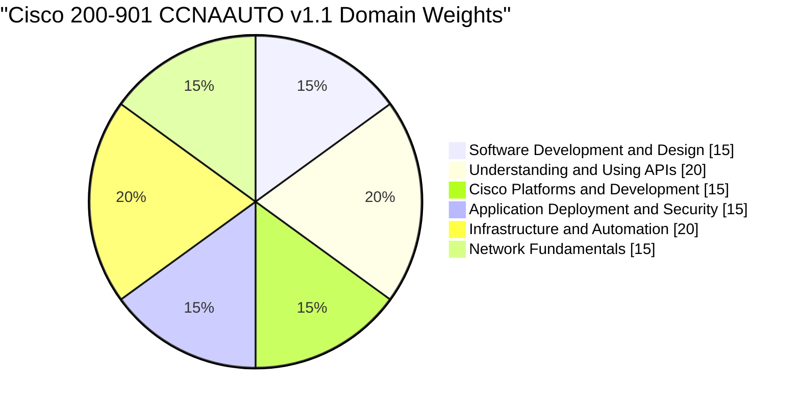
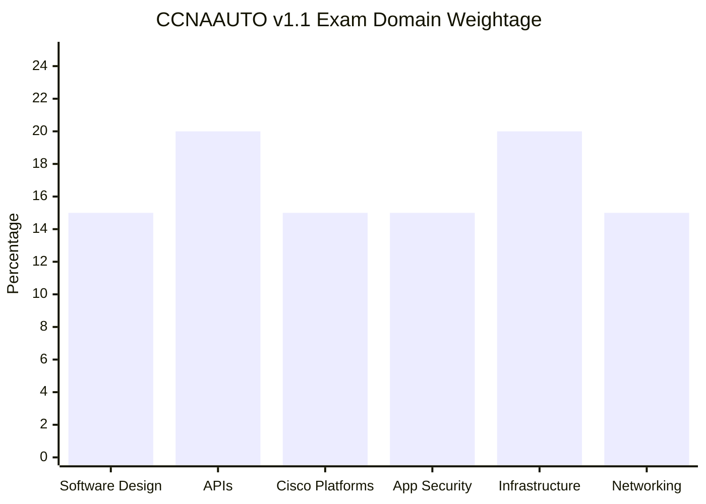
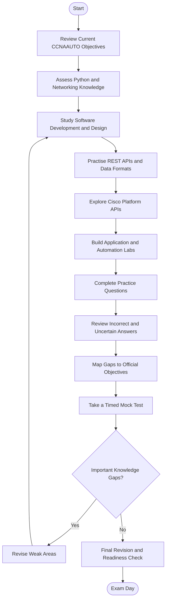
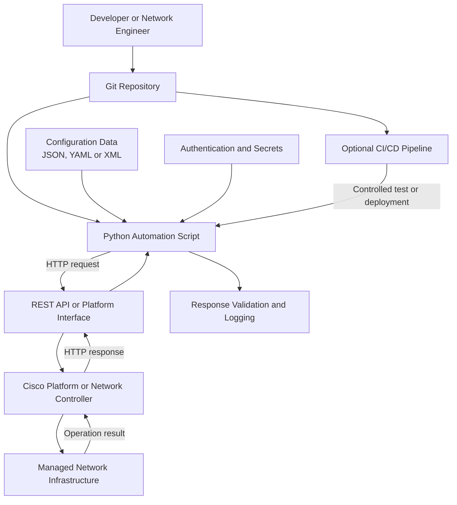
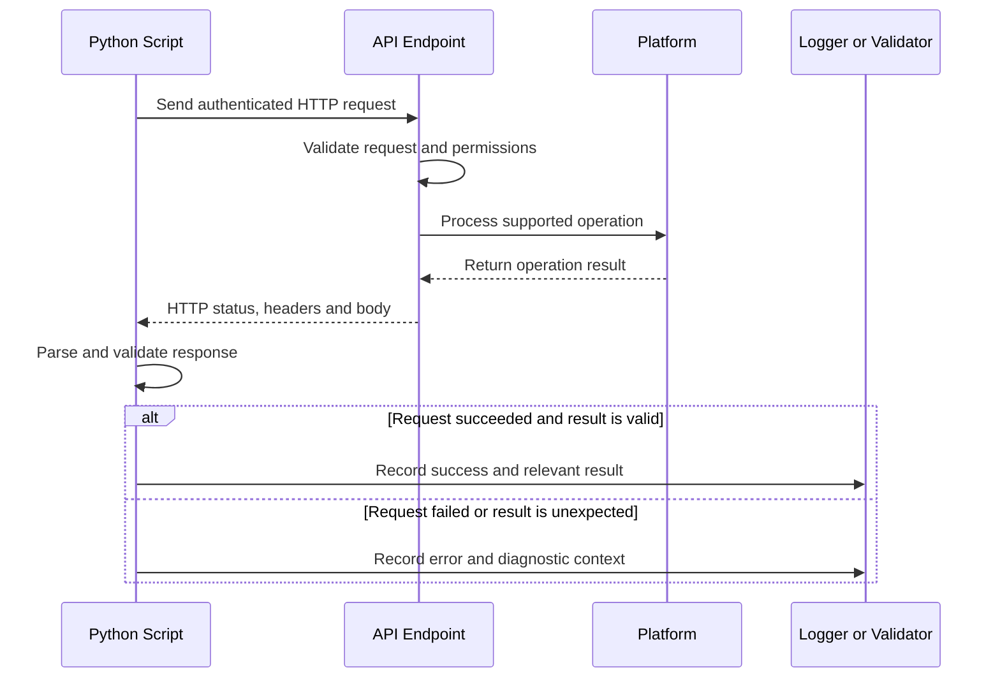
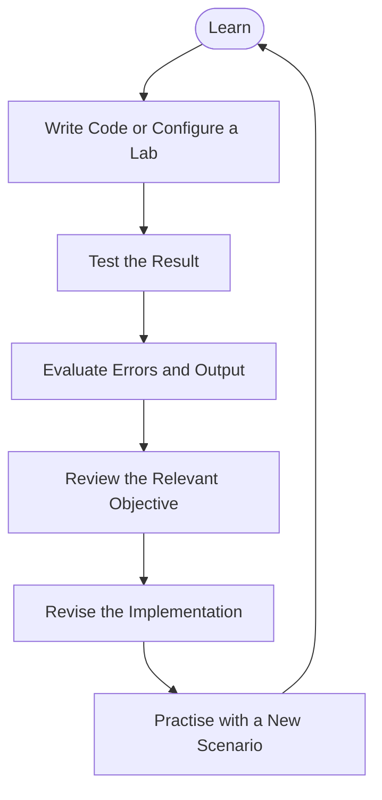
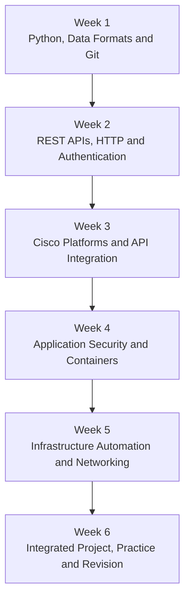

# Cisco 200-901 CCNAAUTO Study Guide — CCNA Automation

A practical study guide for **Cisco 200-901 CCNAAUTO: Automating Networks Using Cisco Platforms**, the core exam for the **CCNA Automation** certification.

This repository helps learners develop the programming, API, application-security, Cisco platform, and infrastructure-automation skills used in modern network operations. It includes exam objectives, Mermaid diagrams, Python examples, hands-on project ideas, original practice questions, and official Cisco learning resources.

> **Current exam:** 200-901 CCNAAUTO v1.1  
> **Certification:** CCNA Automation  
> **Official exam page:** [Cisco 200-901 CCNAAUTO](https://www.cisco.com/site/us/en/learn/training-certifications/exams/ccnaauto.html)  
> **Exam blueprint:** [Official CCNAAUTO v1.1 exam topics PDF](https://learningcontent.cisco.com/documents/marketing/exam-topics/200-901-CCNAAUTO_v.1.1.pdf)

---

## Table of Contents

- [Overview](#overview)
- [About CCNA Automation](#about-ccna-automation)
- [Who Should Prepare?](#who-should-prepare)
- [Exam Information](#exam-information)
- [Official Exam Objectives](#official-exam-objectives)
- [Exam Domain Weightage](#exam-domain-weightage)
- [Preparation Flowchart](#preparation-flowchart)
- [Network Automation Architecture](#network-automation-architecture)
- [API Automation Workflow](#api-automation-workflow)
- [Circular Study and Revision Cycle](#circular-study-and-revision-cycle)
- [Step-by-Step Preparation Guide](#step-by-step-preparation-guide)
- [Suggested Study Roadmap](#suggested-study-roadmap)
- [Practice Questions](#practice-questions)
- [Hands-On Labs and Projects](#hands-on-labs-and-projects)
- [Common Preparation Mistakes](#common-preparation-mistakes)
- [Career Relevance](#career-relevance)
- [Frequently Asked Questions](#frequently-asked-questions)
- [Official and Additional Resources](#official-and-additional-resources)
- [About CertsGate](#about-certsgate)

---

## Overview

Network automation uses software, APIs, scripts, and repeatable workflows to manage infrastructure more consistently than manual, device-by-device operations.

The Cisco 200-901 CCNAAUTO exam brings software development and networking together. Candidates need to understand how programs are organized, how applications communicate through APIs, how Cisco platforms expose programmable interfaces, how applications are deployed securely, and how infrastructure automation works.

This **Cisco 200-901 study guide** organizes preparation into six official domains:

- Software Development and Design
- Understanding and Using APIs
- Cisco Platforms and Development
- Application Deployment and Security
- Infrastructure and Automation
- Network Fundamentals

The practical approach is straightforward: learn the concept, write or inspect a small example, test the result, and explain why the solution works.

Use this repository with Cisco's current exam topics and official learning materials. It is intended to supplement technical learning rather than replace the official blueprint.

## About CCNA Automation

The **CCNA Automation** certification validates foundational knowledge of software development and design, APIs, Cisco platforms, application deployment and security, and infrastructure automation.

Cisco's current certification page identifies **Automating Networks Using Cisco Platforms (200-901 CCNAAUTO)** as the core exam.

This certification is relevant to professionals who want to understand how software and automation can improve network operations, infrastructure management, and repeatable IT workflows.

Official references:

- [CCNA Automation certification](https://www.cisco.com/site/us/en/learn/training-certifications/certifications/automation/ccna-automation/index.html)
- [200-901 CCNAAUTO exam details](https://www.cisco.com/site/us/en/learn/training-certifications/exams/ccnaauto.html)
- [Official exam topics](https://learningcontent.cisco.com/documents/marketing/exam-topics/200-901-CCNAAUTO_v.1.1.pdf)

### Current CCNAAUTO versus legacy DEVASC

| Item | Current exam | Older exam material |
|---|---|---|
| Exam code | 200-901 | 200-901 |
| Exam identifier | CCNAAUTO | DEVASC |
| Exam name | Automating Networks Using Cisco Platforms | DevNet Associate Exam |
| Certification associated with the exam | CCNA Automation | DevNet Associate |
| Blueprint used in this repository | CCNAAUTO v1.1 | Not used as the current blueprint |

Because the code has been reused, checking the exam identifier is essential. A resource that says only “200-901” may refer to a different exam version and certification.

## Who Should Prepare?

This exam is suitable for learners who want to build a foundation in network programmability and automation, including:

- Network engineers exploring Python and APIs.
- IT professionals moving from manual administration to automated workflows.
- Developers interested in network and infrastructure integrations.
- Network administrators learning configuration automation.
- Students beginning a career in network automation.
- Cisco certification candidates seeking the CCNA Automation credential.

Cisco lists no formal prerequisite for the exam. However, familiarity with basic networking, IP addressing, command-line tools, and elementary programming concepts will make the material easier to follow.

If Python is new to you, start with variables, lists, dictionaries, loops, functions, exceptions, and file handling before moving to API scripts and automation workflows.

---

## Exam Information

| Item | Current details |
|---|---|
| Exam code | 200-901 CCNAAUTO |
| Exam name | Automating Networks Using Cisco Platforms |
| Certification | CCNA Automation |
| Provider | Cisco |
| Blueprint version referenced | v1.1 |
| Duration | 120 minutes |
| Languages listed | English and Japanese |
| Price listed by Cisco | US$300 or Cisco Learning Credits |
| Formal prerequisites | None listed |
| Result format | Pass/fail |
| Result availability | Cisco states results are typically available online within 48 hours |
| Question count | Not stated here because a current official count was not verified |
| Numerical passing score | Not published as a fixed public score in the official information referenced here |

Exam details can change. Check Cisco's current exam page before scheduling.

Source: [Cisco 200-901 CCNAAUTO](https://www.cisco.com/site/us/en/learn/training-certifications/exams/ccnaauto.html)

---

## Official Exam Objectives

The current CCNAAUTO v1.1 blueprint has six domains. Use the official exam topics PDF for the complete task-level objectives.

### 1. Software Development and Design — 15%

Understand how software is structured, developed, tested, and maintained.

Study:

- XML, JSON, and YAML data formats.
- Parsing structured data into Python data structures.
- Test-driven development.
- Agile, lean, and waterfall development methods.
- Functions, methods, classes, and modules.
- Model-View-Controller (MVC) and Observer design patterns.
- Version control and Git.
- Cloning repositories and managing files.
- Committing, pushing, pulling, branching, and merging.
- Comparing changes and handling merge conflicts.

**Practical focus:** Write a small Python program that reads structured data, validates it, and produces a predictable result. Track the changes with Git.

### 2. Understanding and Using APIs — 20%

Learn how applications exchange information and perform actions through documented interfaces.

Study:

- Constructing REST API requests from documentation.
- HTTP methods and request structure.
- Response status codes, headers, and bodies.
- API authentication using basic authentication, tokens, and API keys.
- Webhook usage patterns.
- API constraints, including rate limits and request requirements.
- Troubleshooting failed requests.
- REST and RPC styles.
- Synchronous and asynchronous interactions.
- Calling REST APIs from Python using the `requests` library.

**Practical focus:** Read API documentation, send a request, inspect the response, handle an error, and explain why the request succeeded or failed.

### 3. Cisco Platforms and Development — 15%

Understand how Cisco platforms expose capabilities for programmable operations and integration.

The exam blueprint covers Cisco platform APIs, development environments, and platform-related development concepts. Study the specific platform technologies and tasks named in the current official objectives.

Practise:

- Reading platform API documentation.
- Understanding authentication and authorization requirements.
- Identifying the resources exposed by an API.
- Constructing requests and interpreting responses.
- Using platform capabilities in a small automation workflow.
- Handling errors and validating returned data.

**Practical focus:** Choose an authorized Cisco platform or learning environment, inspect its API documentation, and build a script that retrieves or updates a supported resource.

### 4. Application Deployment and Security — 15%

Learn how applications are packaged, deployed, and protected.

Study:

- Application-security risks and mitigation approaches.
- Common web and application vulnerabilities.
- Encryption, hashes, and digital signatures.
- Secure development practices.
- Containers and container images.
- Dockerfiles and container operations.
- Deployment considerations.
- Security controls for applications and network services.

**Practical focus:** Package a small application in a container, configure it safely, and document the difference between the application code, its dependencies, and its runtime environment.

### 5. Infrastructure and Automation — 20%

Understand how infrastructure can be managed through repeatable, software-driven workflows.

Study:

- Controller-based versus device-level management.
- Infrastructure as Code (IaC).
- Configuration management and automation concepts.
- Continuous Integration and Continuous Delivery (CI/CD).
- Ansible, Puppet, and Chef.
- Cisco Network Services Orchestrator (NSO).
- Automation workflows and task orchestration.
- Repeatability, idempotency, and validation.
- Managing changes consistently across infrastructure.

**Practical focus:** Automate a small configuration or data-validation task. Include checks that detect unexpected results instead of assuming every operation succeeded.

### 6. Network Fundamentals — 15%

Understand the networking concepts that automated systems must interact with.

Study the specific networking tasks in Cisco's current blueprint, including relevant concepts around network addressing, protocols, devices, and network communication.

Build a solid foundation in:

- IPv4 and IPv6 addressing.
- TCP and UDP.
- DNS and common application protocols.
- Routing and switching fundamentals.
- Network device roles.
- Ports, interfaces, and connectivity.
- How network behavior affects automation tasks.

**Practical focus:** Given a connectivity issue, identify whether the likely problem is addressing, routing, a service, an API endpoint, authentication, or the automation logic itself.

**Official source:** [Download the CCNAAUTO v1.1 exam topics PDF](https://learningcontent.cisco.com/documents/marketing/exam-topics/200-901-CCNAAUTO_v.1.1.pdf)

---

## Exam Domain Weightage

Cisco publishes the following domain percentages for **200-901 CCNAAUTO v1.1**.

### Official domain distribution



### Compare the weights



| Official domain | Weight |
|---|---:|
| Software Development and Design | 15% |
| Understanding and Using APIs | 20% |
| Cisco Platforms and Development | 15% |
| Application Deployment and Security | 15% |
| Infrastructure and Automation | 20% |
| Network Fundamentals | 15% |
| **Total** | **100%** |

Source: [Cisco CCNAAUTO v1.1 exam topics](https://learningcontent.cisco.com/documents/marketing/exam-topics/200-901-CCNAAUTO_v.1.1.pdf)

### How to use the weightage

- Give additional attention to APIs and Infrastructure and Automation because each represents 20% of the published blueprint.
- Cover all four 15% domains rather than treating them as optional.
- Practise integrated tasks that combine Python, APIs, data formats, and networking.
- Recheck the official blueprint before the exam in case Cisco updates the objectives.

The percentages help organize study time, but they do not indicate exactly how many questions will appear from each domain.

---

## Preparation Flowchart

Use this workflow to turn the official blueprint into a practical study plan. A failed exercise or uncertain practice answer should lead back to the relevant concept and a new attempt.



This is an independent preparation workflow, not an official Cisco examination process.

## Network Automation Architecture

Automation commonly connects a script or orchestration tool to an API-enabled platform. The platform validates the request, performs the supported operation, and returns a response that the automation workflow should check.

The following is a **conceptual architecture** for learning. It is not a prescribed Cisco deployment.



### Component responsibilities

| Component | Role |
|---|---|
| Git repository | Tracks source code and changes. |
| Python script | Implements the automation logic and handles errors. |
| JSON, YAML, or XML | Represents structured data and configuration. |
| Authentication and secrets | Provides credentials or tokens needed for authorized access. |
| REST API | Exposes documented resources and operations. |
| Cisco platform | Processes supported API operations. |
| Network infrastructure | Provides the underlying network services and devices. |
| Response validation | Checks status codes, response data, and expected outcomes. |
| CI/CD pipeline | Can automate tests and controlled deployment steps. |

A successful HTTP response does not automatically prove that the intended network state has been achieved. Good automation verifies the result and reports failures clearly.

---

## API Automation Workflow

This sequence shows how a script can interact with an API and respond to its result.



### Example: calling a REST API with Python

The following example demonstrates the structure of an API request. It uses a placeholder endpoint and an environment variable for the token; it is not a live Cisco API endpoint.

```python
import os
import requests

api_url = "https://api.example.com/v1/resources"
token = os.environ["API_TOKEN"]

headers = {
    "Authorization": f"Bearer {token}",
    "Accept": "application/json",
}

try:
    response = requests.get(
        api_url,
        headers=headers,
        timeout=15,
    )

    response.raise_for_status()
    data = response.json()

    print("Request succeeded.")
    print(data)

except requests.exceptions.Timeout:
    print("The API request timed out.")

except requests.exceptions.HTTPError as exc:
    print(f"HTTP error: {exc}")

except requests.exceptions.RequestException as exc:
    print(f"Request failed: {exc}")

except ValueError:
    print("The response was not valid JSON.")
```

Important points:

- Replace the example URL with an authorized endpoint documented by the platform.
- Supply the token securely through the environment or an approved secret-management mechanism.
- Confirm the platform's required authentication method; not every API uses bearer tokens.
- Check the response format and API documentation before relying on a particular field.
- Avoid logging access tokens, passwords, or sensitive response data.

---

## Circular Study and Revision Cycle

Automation skills develop through repeated experimentation. Reading API documentation is useful, but writing a request, inspecting the response, and correcting mistakes helps turn that knowledge into practical ability.



- **Learn:** Study one objective and its terminology.
- **Practise:** Write code, inspect an API, or configure an automation tool.
- **Evaluate:** Check output, status codes, and expected behavior.
- **Review:** Find the actual cause of an error rather than changing code randomly.
- **Revise:** Update the implementation or return to the documentation.
- **Practise again:** Test the concept using a different input or scenario.

---

## Step-by-Step Preparation Guide

### Step 1: Assess your foundation

Check your knowledge of Python, data structures, Git, HTTP, and network fundamentals. If one of these is unfamiliar, build that foundation before tackling integrated automation scripts.

### Step 2: Learn Python and structured data

Practise:

- Variables, conditionals, loops, and functions.
- Lists and dictionaries.
- Reading and writing files.
- Exceptions and error handling.
- Parsing JSON, YAML, and XML.
- Organizing code into reusable modules.

Write small programs that parse a configuration file and validate required fields.

### Step 3: Understand Git and software design

Create a small repository and practise cloning, branching, committing, pushing, pulling, comparing changes, and resolving a merge conflict.

Learn why functions and modules improve maintainability. Understand the purpose of common design patterns and development approaches in the context of the official objectives.

### Step 4: Master REST APIs

Learn the structure of an HTTP request and response. Practise identifying:

- URL and resource path.
- HTTP method.
- Headers and authentication.
- Request body and content type.
- Status code.
- Response headers and body.

Study common status codes such as `200`, `201`, `204`, `400`, `401`, `403`, `404`, `409`, `429`, and `500`. Their precise meaning depends on the API and its documentation.

### Step 5: Explore Cisco platforms

Use official Cisco documentation or a supported learning environment to find an API endpoint, understand its authentication requirements, and make an authorized request.

Focus on interpreting the platform response and building reliable error handling. Avoid assuming that all Cisco platforms expose identical resources or use the same API conventions.

### Step 6: Learn application deployment and security

Understand how application code, dependencies, configuration, and runtime environments fit together. Practise building a simple container and checking how the application starts and handles configuration.

Review secure development practices and keep credentials out of source control.

### Step 7: Study infrastructure automation

Understand the purpose of configuration management, Infrastructure as Code, orchestration, and CI/CD. Compare controller-based workflows with direct device-level management.

Practise making a change repeatable, checking whether it succeeded, and ensuring that an error does not silently produce an incorrect state.

### Step 8: Connect automation with networking

Use networking knowledge to diagnose failures. An API request may fail because of DNS resolution, routing, TLS, a firewall, authentication, permissions, or application logic.

Learn to distinguish these causes rather than treating every failure as a Python problem.

### Step 9: Practise and review

Answer original practice questions, complete labs, and take timed mock tests. For every mistake, identify the objective and repeat a related exercise.

### Step 10: Perform final revision

Review the current official blueprint, your code examples, API troubleshooting notes, Git commands, security concepts, and network fundamentals. Confirm the exam logistics using Cisco's official page.

---

## Suggested Study Roadmap

This six-week plan is an **independent study recommendation**, not a Cisco-mandated schedule. Adjust it based on your current programming and networking experience.



| Week | Main focus | Suggested outcome |
|---|---|---|
| 1 | Python basics, JSON/YAML/XML, Git, software design | A version-controlled script that parses and validates structured data |
| 2 | HTTP, REST, API authentication, webhooks, status codes | A small API client with error handling |
| 3 | Cisco platform APIs and development | A documented integration using an authorized platform endpoint |
| 4 | Application security, containers, deployment | A simple containerized application with safe configuration |
| 5 | IaC, automation tools, CI/CD, networking | A repeatable workflow with validation and failure handling |
| 6 | Integrated project, practice questions, mock tests | A completed project and objective-based readiness checklist |

The best use of study time is active practice. For example, after learning HTTP status codes, deliberately test how your script responds to a successful request, an invalid request, a permission failure, and a timeout.

---

## Practice Questions

These are **original educational questions** created for this repository. They are not actual, leaked, or official Cisco exam questions.

### Question 1: Structured data

A Python script needs to represent a JSON object containing a device name and its IP address. Which Python data structure is most directly suited to storing the key-value pairs after parsing?

A. Dictionary  
B. Set of unrelated strings  
C. File handle  
D. Exception object  

**Correct answer: A**

**Explanation:** JSON objects map naturally to Python dictionaries. The script can access fields by key, validate their values, and use them in later processing.

### Question 2: HTTP status codes

An API request returns `401 Unauthorized`. What should you investigate first?

A. Whether the Python program uses a class  
B. Whether the request's authentication credentials or token are valid and correctly supplied  
C. Whether the local Git repository has a remote branch  
D. Whether the server uses a different operating system  

**Correct answer: B**

**Explanation:** A `401` response commonly indicates an authentication problem. Verify the required authentication mechanism, token validity, headers, and API documentation. A `403` response more commonly indicates that the request is understood but access is forbidden.

### Question 3: Git workflow

You have modified a Python script and want to save a version-controlled snapshot in the local Git repository. Which command creates a commit after the changes have been staged?

A. `git status`  
B. `git commit -m "Add API handling"`  
C. `git branch --list`  
D. `git diff --stat`  

**Correct answer: B**

**Explanation:** `git commit` records the staged changes as a new commit. The `git add` command is typically used to stage changes before committing.

### Question 4: API reliability

A script sends a request to a remote API and sometimes receives a timeout. What is a reasonable first improvement?

A. Remove all error handling  
B. Add a suitable timeout and explicit error handling, then consider safe retry behavior where appropriate  
C. Print the API token to the terminal  
D. Assume that every timeout means the operation failed before reaching the server  

**Correct answer: B**

**Explanation:** Timeouts should be handled deliberately. A request may have reached the server even if the client did not receive the response, so automatic retries of state-changing operations require care and should follow the API's idempotency and retry guidance.

### Question 5: Infrastructure automation

Why is validation important after an automated configuration change?

A. It proves that every device in the network is secure  
B. It checks whether the observed result matches the intended state  
C. It removes the need for testing  
D. It guarantees that future changes will never fail  

**Correct answer: B**

**Explanation:** Automation should verify outcomes instead of assuming success. Validation helps detect incomplete changes, API errors, and differences between the desired and actual state.

### How to use practice questions effectively

1. Explain why the correct answer fits the scenario.
2. Explain why the other options are unsuitable.
3. Map the question to the relevant official exam objective.
4. Review the relevant documentation or code.
5. Reproduce the concept in a small lab.
6. Test yourself again with a different example.

A mock-test result is one readiness indicator, not a guarantee of certification success.

---

## Hands-On Labs and Projects

Use a local development environment, public learning resources, or an authorized Cisco lab. Never automate changes on production infrastructure without the necessary authorization, testing, and change controls.

### Lab 1: Parse and validate network inventory

**Objective:** Practise Python and structured data.

Tasks:

- Create a small JSON or YAML file listing fictional devices.
- Include fields such as device name, management address, and device role.
- Parse the file into Python data structures.
- Validate that required fields exist.
- Report missing or malformed values.
- Store the code and sample data in Git.

**Deliverable:** A reusable inventory-validation script with sample input and output.

### Lab 2: Build a REST API client

**Objective:** Practise HTTP requests and response handling.

Tasks:

- Choose a public API or authorized test endpoint.
- Read its documentation.
- Send a request with the required headers.
- Parse a JSON response.
- Handle common errors and timeouts.
- Add input validation and basic logging.
- Keep credentials out of source code.

**Deliverable:** A Python API client with clear instructions and documented limitations.

### Lab 3: Use a Cisco platform API

**Objective:** Connect API knowledge to a Cisco environment.

Tasks:

- Select a supported Cisco learning platform or lab.
- Identify an API endpoint from official documentation.
- Review authentication and authorization requirements.
- Send a permitted read request.
- Parse and validate the response.
- Document errors encountered and how they were resolved.

**Deliverable:** A small integration script and an explanation of the API workflow.

### Lab 4: Practise Git collaboration

**Objective:** Build confidence with source control.

Tasks:

- Create a local repository.
- Make a branch for a new feature.
- Modify a script and commit the changes.
- Merge the branch.
- Practise resolving a simple merge conflict.
- Use `git diff` to inspect changes.

**Deliverable:** A repository with a clear commit history and a short explanation of the workflow.

### Lab 5: Containerize a small application

**Objective:** Learn basic application packaging and deployment.

Tasks:

- Create a small Python application.
- Add a `requirements.txt` file where dependencies are needed.
- Write a Dockerfile.
- Build and run the container.
- Pass configuration through environment variables.
- Test how the application behaves when required configuration is missing.
- Document how to rebuild and run the application.

**Deliverable:** A simple containerized application with reproducible instructions.

### Lab 6: Create a repeatable automation workflow

**Objective:** Understand infrastructure automation and validation.

Tasks:

- Define a small, safe configuration or data-processing task.
- Store the desired input in a version-controlled file.
- Implement the workflow with an appropriate tool or Python script.
- Validate inputs before applying changes.
- Record the result and report errors.
- Test repeated execution and check whether it causes unnecessary changes.
- Add automated tests where practical.

**Deliverable:** A repeatable workflow with validation and documented failure handling.

### Capstone project: Network inventory and API automation

Build a small project that:

- Reads a JSON or YAML inventory.
- Validates device records.
- Calls an authorized API or test endpoint.
- Parses and summarizes the response.
- Handles authentication errors and timeouts.
- Logs relevant results without exposing secrets.
- Uses Git for version control.
- Includes automated tests or documented test cases.
- Provides a README explaining setup, assumptions, and limitations.

A good project demonstrates reasoning and safe implementation—not just the number of tools used.

---

## Common Preparation Mistakes

### Using legacy DEVASC study material without checking it

The 200-901 exam code has been reused. Verify that resources identify **CCNAAUTO** and match the current v1.1 exam topics.

### Learning Python syntax without building anything

Knowing the syntax is a starting point. Write small programs that read files, parse data, make requests, handle exceptions, and validate results.

### Memorizing HTTP status codes without understanding the request

When an API call fails, review the endpoint, method, headers, authentication, request body, response status, and documented constraints.

### Ignoring error handling

A script that works only when every request succeeds is fragile. Test timeouts, invalid data, authentication failures, and unexpected responses.

### Treating automation as a sequence of commands

Reliable automation includes validation, error handling, logging, and checks that the final state matches expectations.

### Storing secrets in source control

Never commit API tokens, passwords, private keys, or production credentials. Use environment variables or an appropriate secrets-management mechanism.

### Skipping network fundamentals

Automation interacts with real network services. DNS, routing, TCP, TLS, and access controls can affect a request even when the Python code is correct.

### Taking practice tests without reviewing mistakes

Use practice questions to identify weak objectives, then revisit the relevant documentation and implement a small example.

---

## Career Relevance

CCNA Automation preparation can help develop foundational skills for work involving:

- Network automation.
- Network programmability.
- Infrastructure operations.
- API integrations.
- Python-based IT tooling.
- Configuration management.
- Application deployment.
- Infrastructure as Code.
- Network engineering with automation responsibilities.

A certification can help structure learning, but practical experience remains important. Projects that show how you validate inputs, handle failures, manage source code, and document results can demonstrate useful skills to employers.

---

## Frequently Asked Questions

### What is Cisco 200-901 CCNAAUTO?

It is **Automating Networks Using Cisco Platforms**, the core exam for Cisco's CCNA Automation certification.

### Is 200-901 still the DevNet Associate exam?

No. The current exam associated with 200-901 is CCNAAUTO for CCNA Automation. Older DEVASC material may use the same code, so check the exam identifier and blueprint before studying.

### How long is the current exam?

Cisco lists a duration of **120 minutes**. Confirm the current details on the [official CCNAAUTO exam page](https://www.cisco.com/site/us/en/learn/training-certifications/exams/ccnaauto.html).

### What are the official exam domains?

The current v1.1 blueprint lists six domains: Software Development and Design, Understanding and Using APIs, Cisco Platforms and Development, Application Deployment and Security, Infrastructure and Automation, and Network Fundamentals.

### Which domains have the highest published weights?

Understanding and Using APIs and Infrastructure and Automation each carry **20%** of the v1.1 blueprint. The other four domains each carry 15%.

### Do I need to be an experienced programmer?

Cisco lists no formal prerequisites. However, basic Python and networking knowledge will help. If you are new to programming, begin with data structures, functions, files, exceptions, and simple scripts before moving to API automation.

### Do I need to know Python for this exam?

The blueprint includes Python-related programming and API tasks. Practising Python, structured data, and API requests is therefore an important part of preparation.

### Are the practice questions in this repository official?

No. They are original educational questions. Use Cisco's official exam topics and learning resources as your primary references.

### Where can I find official training?

Start with the [Cisco CCNA Automation certification page](https://www.cisco.com/site/us/en/learn/training-certifications/certifications/automation/ccna-automation/index.html) and the [official exam page](https://www.cisco.com/site/us/en/learn/training-certifications/exams/ccnaauto.html). Cisco provides learning paths, training options, and practice resources through its learning ecosystem.

---

## Official and Additional Learning Resources

| Resource | Purpose |
|---|---|
| [Cisco 200-901 CCNAAUTO exam page](https://www.cisco.com/site/us/en/learn/training-certifications/exams/ccnaauto.html) | Current exam information and preparation options |
| [CCNA Automation certification](https://www.cisco.com/site/us/en/learn/training-certifications/certifications/automation/ccna-automation/index.html) | Certification details and requirements |
| [Official CCNAAUTO v1.1 exam topics](https://learningcontent.cisco.com/documents/marketing/exam-topics/200-901-CCNAAUTO_v.1.1.pdf) | Complete domain and task-level objectives |
| [Cisco U.](https://u.cisco.com/) | Cisco learning paths and technical training |
| [Cisco Networking Academy](https://www.netacad.com/) | Networking and programming learning resources |
| [Python documentation](https://docs.python.org/3/) | Python language and standard library reference |
| [Requests documentation](https://requests.readthedocs.io/) | HTTP requests in Python |
| [Git documentation](https://git-scm.com/doc) | Version control concepts and commands |
| [Docker documentation](https://docs.docker.com/) | Containers and application packaging |
| [Ansible documentation](https://docs.ansible.com/) | Automation and configuration management |
| [CertsGate](https://certsgate.com/) | Independent certification preparation resources |

Always prioritize the current Cisco exam topics over older books, course outlines, or third-party summaries.

---

## About CertsGate

[CertsGate](https://certsgate.com/) is an independent IT certification preparation resource. Candidates preparing for 200-901 can visit the [CertsGate 200-901 page](https://certsgate.com/exams/cisco/200-901) to explore relevant preparation material.

For the best learning experience, combine supplementary resources with the official blueprint and practical work:

1. Review the current CCNAAUTO objectives.
2. Study the relevant programming, API, security, and automation concepts.
3. Build small scripts and test them.
4. Use practice questions to identify uncertain topics.
5. Revisit official documentation when an explanation is unclear.
6. Complete an integrated project and assess readiness with a timed mock test.

Because the exam code has been reused, verify that any third-party material is aligned with **CCNAAUTO v1.1**, not the older DEVASC exam.
